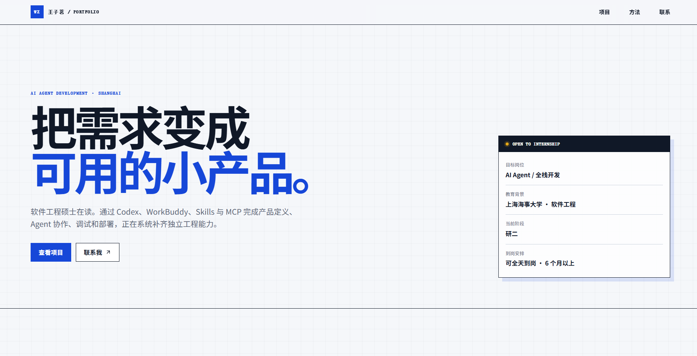
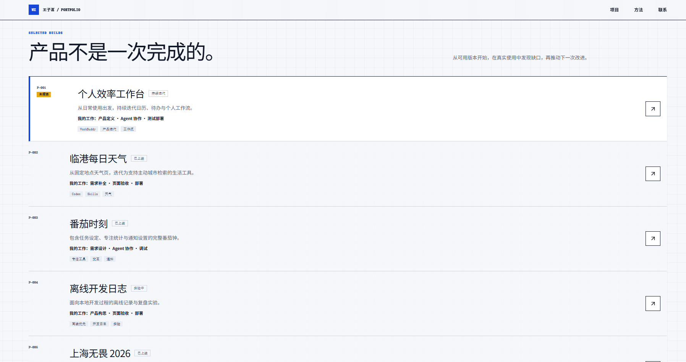
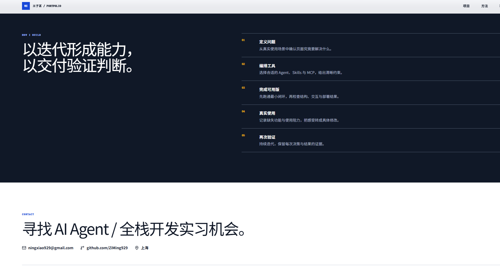
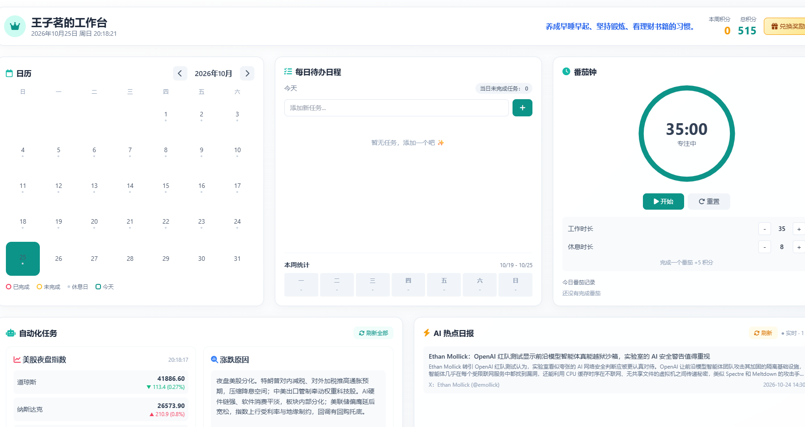
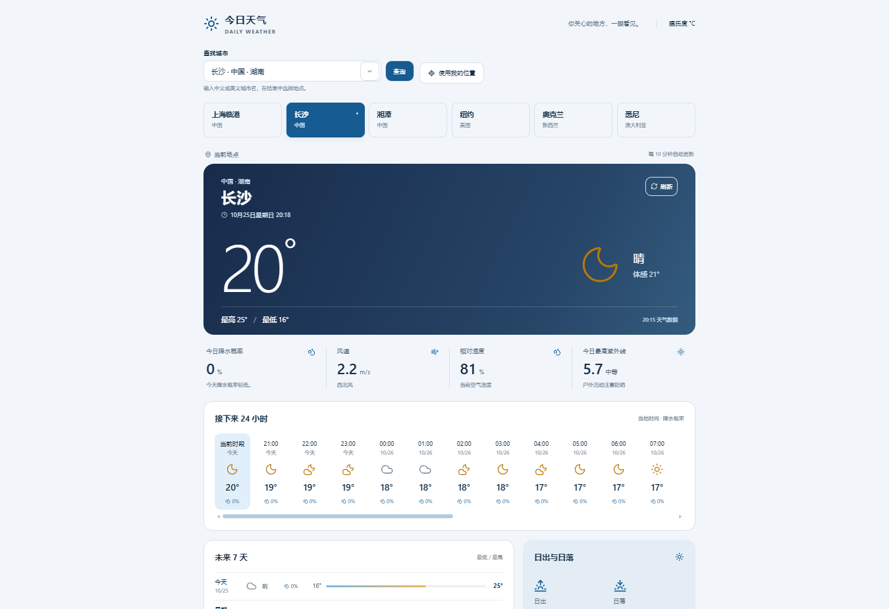
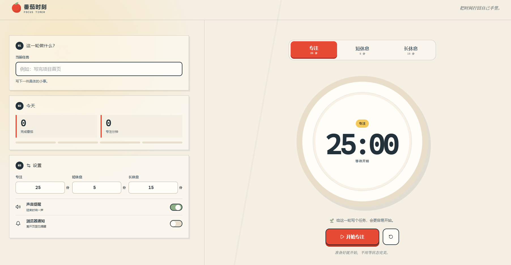
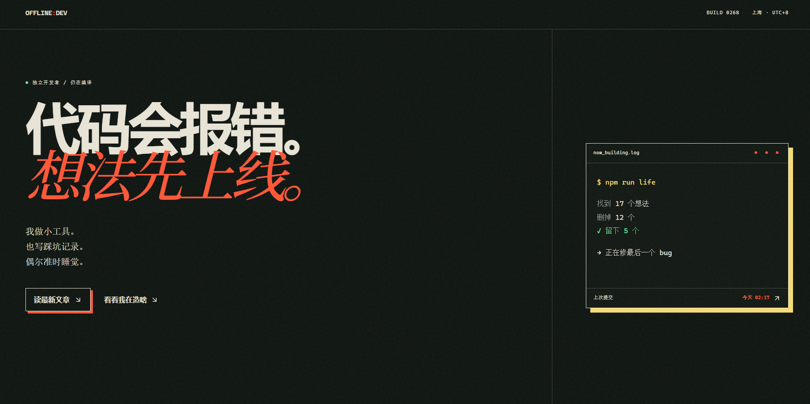
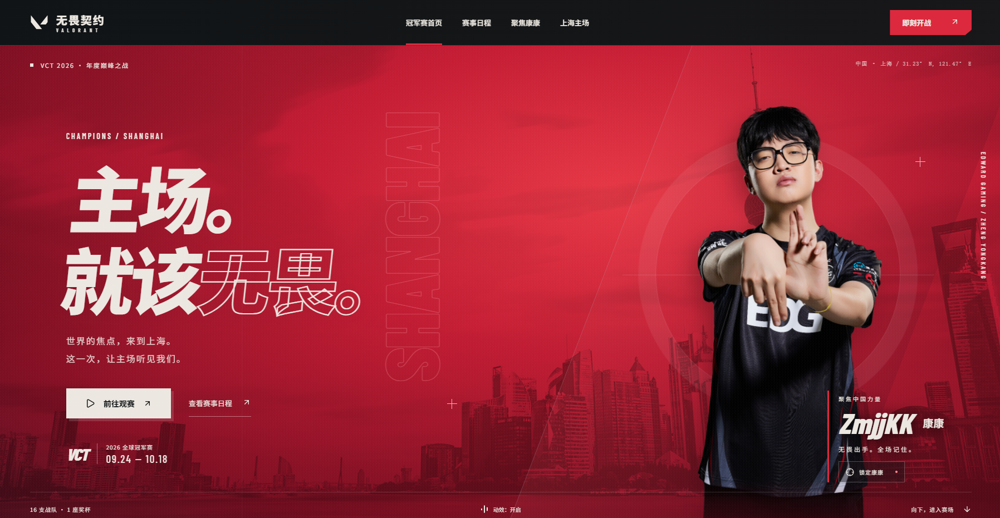
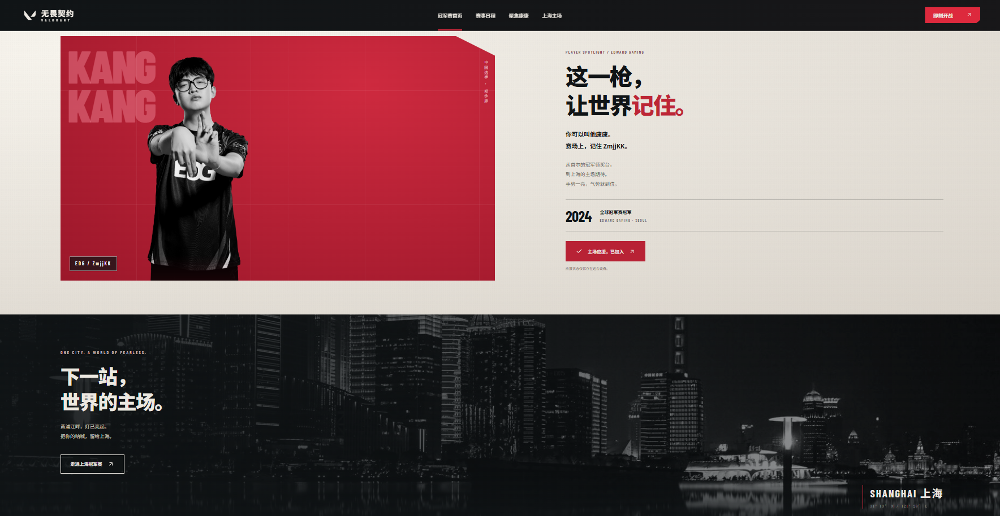

# AI Agent Portfolio · 个人作品集与创意实验室

> 把需求变成可用的小产品。记录 AI 辅助开发、个人项目实践与持续迭代的过程。

这是一个用于展示个人开发经历、AI Agent 探索及独立 Demo 作品的个人作品集项目。项目以个人主页为入口，集中呈现项目介绍、开发理念与多个交互式作品，既是技术实践记录，也是面向实习招聘的作品展示窗口。

**项目定位：** 个人作品集 / AI 辅助开发实践 / Web 应用 Demo 展示  
**GitHub：** [ai-agent-portfolio](https://github.com/ZiMing929/ai-agent-portfolio)（仓库创建并推送后可访问）  
**部署状态：** 当前以源码与截图展示为主；在线演示地址待补充。

## ✨ 项目亮点

- **统一的作品展示入口：** 通过个人主页介绍开发方向、作品与成长轨迹，方便招聘人员快速了解项目。
- **多风格页面实践：** 包含简洁的作品集页面、深色个人博客及电竞主题视觉页面。
- **实用工具 Demo：** 展示天气查询、番茄钟及个人工作台等面向日常使用场景的功能界面。
- **AI 辅助开发工作流：** 结合 Codex 等 AI 编程工具进行需求拆解、页面实现、调试和迭代，注重理解与验证生成的代码。
- **持续迭代：** 将不同创意整理成独立作品，逐步积累可展示、可维护的项目经验。

## 🖼️ 页面展示

### 01｜个人主页

以“把需求变成可用的小产品”为核心表达，展示个人定位与项目入口。



### 02｜作品集与项目历程

集中展示个人项目与开发经历，让访问者快速了解做过的产品及实践方向。



### 03｜开发理念与个人介绍

通过深色视觉页面呈现技术理念、个人能力和发展方向。



### 04｜个人效率工作台

整合日历、任务、计时等信息模块，探索个人效率工具的界面组织方式。



### 05｜天气查询 Demo

展示城市天气、温度、天气趋势与预报信息的可视化界面。



### 06｜番茄钟 Demo

围绕专注计时设计操作界面，提供清晰的倒计时与专注状态展示。



### 07｜个人博客页面

以深色排版和鲜明标题呈现个人内容与技术思考。



### 08｜无畏契约主题展示 · 首页

电竞主题视觉设计实践，展示大幅视觉主图、导航及主题内容区域。



### 09｜无畏契约主题展示 · 内容页

延续电竞视觉风格，探索内容编排、卡片布局与页面节奏。



> 上述图片来自项目演示材料，主要用于展示界面设计与实现效果；不代表所有页面已完成线上部署或第三方接口联调。

## 🧰 技术栈

根据当前项目启动日志，已确认的主要技术包括：

| 类别 | 技术 | 用途 |
| --- | --- | --- |
| JavaScript 运行环境 | Node.js | 本地开发与脚本运行 |
| 前端构建 | Vite 8 | 开发服务器与构建流程 |
| Web 框架适配 | Vinext | 项目开发启动入口 |
| 本地运行环境 | Miniflare / Cloudflare Workers | Workers 环境模拟与运行 |
| AI 辅助开发 | Codex 等 | 辅助需求拆解、开发与调试 |

具体框架、样式库、数据来源和部署配置，请以仓库中的 `package.json` 与源码为准。

## 🚀 本地运行

### 环境准备

- 安装符合 `package.json` 要求的 Node.js 版本。
- 安装 npm。
- Windows 环境中如遇 Workers 运行时启动失败，请检查 Microsoft Visual C++ Redistributable 及 `workerd` 兼容性。

### 启动步骤

```bash
# 1. 克隆仓库
git clone https://github.com/ZiMing929/ai-agent-portfolio.git

# 2. 进入项目目录
cd ai-agent-portfolio

# 3. 安装依赖（有 package-lock.json 时）
npm ci

# 4. 启动开发环境
npm run dev
```

> 当前已知：部分 Windows 环境中可能出现 `MiniflareCoreError [ERR_RUNTIME_FAILURE]`。这是本地 Workers 运行时启动问题，尚不能保证所有 Windows 设备开箱即用。请结合 Node.js 版本、VC++ 运行库和项目依赖排查。

## 📂 项目结构

以下是推荐的仓库组织方式（仅作为说明，具体以实际源码为准）：

```text
ai-agent-portfolio/
├── assets/
│   └── screenshots/       # README 演示截图
├── scripts/               # 启动脚本（项目中已有 run-framework.mjs）
├── package.json           # 依赖与 npm 命令
├── package-lock.json      # 依赖锁文件（如有）
└── README.md              # 项目介绍
```

## 💡 开发思路与实践收获

项目的重点不仅是制作页面，还在于将需求逐步转化为可以展示和迭代的作品：

1. **需求拆解：** 明确每个 Demo 的目标用户、核心场景和最小功能。
2. **页面实现：** 关注布局、信息层级、交互反馈和不同视觉风格。
3. **AI 协作：** 利用 AI 编程工具辅助生成方案和代码，再由开发者检查、调试和整合。
4. **问题定位：** 通过终端日志、依赖树与运行环境分析问题，而不是盲目修改业务代码。
5. **成果沉淀：** 用 README、截图和版本管理记录开发过程，方便回顾和面试展示。

## 🗺️ 后续计划

- [ ] 完善本地开发环境兼容性与启动文档
- [ ] 补充每个 Demo 的功能说明和源码入口
- [ ] 优化移动端适配与交互细节
- [ ] 增加在线预览地址及部署说明
- [ ] 持续更新 AI Agent 相关项目和技术实践

## 📄 说明

本仓库用于个人学习、技术交流和作品展示。主题页面中的第三方名称、游戏视觉素材等仅作学习演示；相关商标、肖像与素材版权归原权利人所有。公开部署或商业使用前，请确认素材授权及使用规范。

---

**持续构建，持续记录。让每个小想法都成为可展示的作品。**
